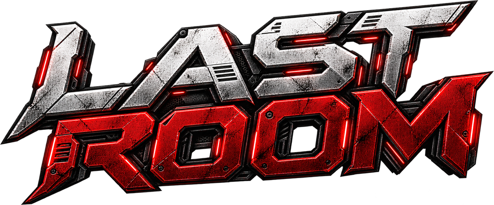
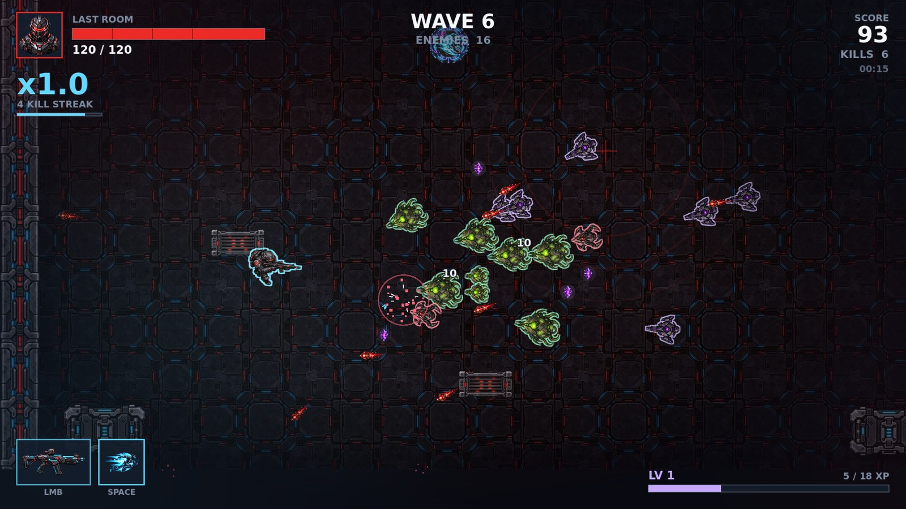
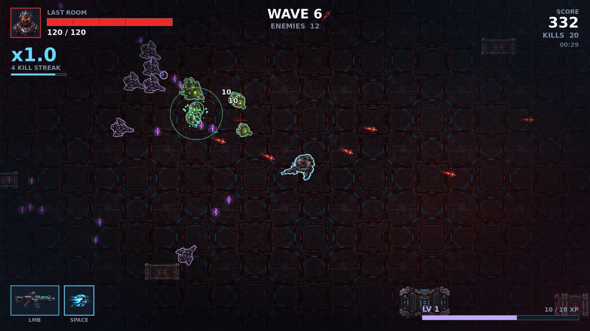
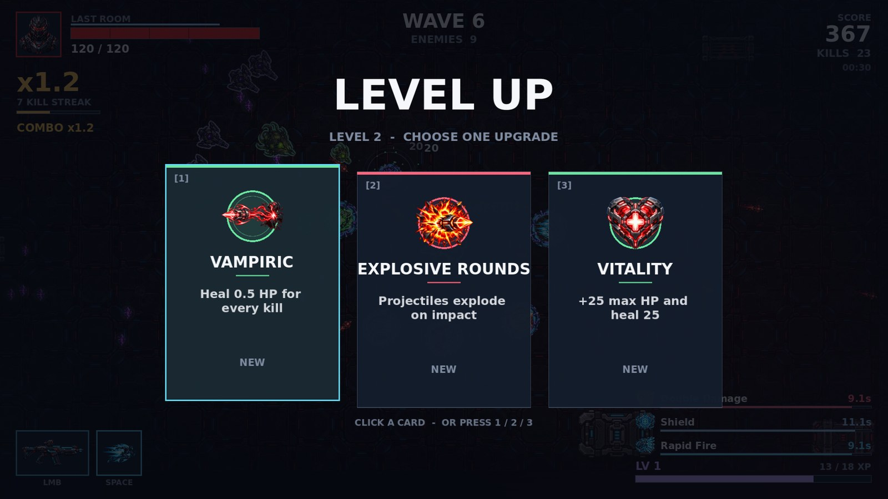
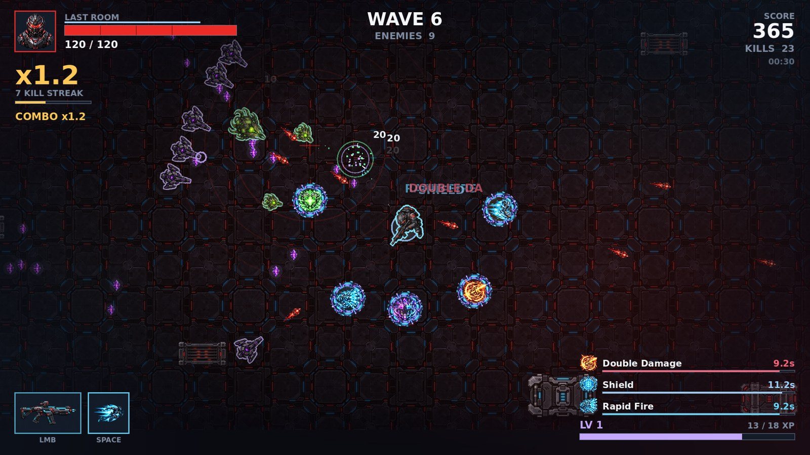

### SURVIVE. ADAPT. GO ONE MORE WAVE.

A fast top-down roguelike survival shooter.
You are locked in a sealed room. The waves never stop. How long can you last?

 

---

## The Game

**Last Room** is a single-room arena shooter built around one loop:

> Survive the wave → collect XP → level up → pick an upgrade → face a harder wave → die → try again.

There is no final wave and no happy ending. The room always wins in the end, so the only goal is to beat your own best wave and best score. Every run plays differently because you choose your upgrades, and the room throws random events at you.

## How to Play

| Action | Control |
|---|---|
| Move | `W` `A` `S` `D` or Arrow keys |
| Aim | Mouse |
| Shoot | Hold Left Mouse Button |
| Dash | `Space` |
| Pause | `Esc` |
| Fullscreen | `F11` |
| Choose an upgrade | Click a card, or press `1` `2` `3` |

**Tips**

- **Keep moving.** Standing still is how you die. Circle the room and shoot while you move.
- **Dash through danger.** The dash makes you invulnerable for a moment. Use it to escape being surrounded or to slip through enemy bullets.
- **Grab the XP orbs.** Enemies drop them, and they fly toward you when you are close. Level-ups are your main source of power.
- **Build a combo.** Kill enemies without taking damage to raise your score multiplier. Getting hit resets it.
- **Think in builds.** Upgrades stack and combine. Pick things that work together instead of grabbing everything.
- **Watch for warnings.** A red screen and a siren mean a boss is coming.

## Features

- **Endless waves** that get tougher in enemy count, health, speed and damage
- **Challenge waves every 5 waves** with stronger enemies
- **A boss every 10 waves**: a huge multi-phase fight with bullet patterns, charge attacks and summoned minions
- **20 upgrades** that stack and combine into very different builds
- **6 temporary power-ups** with on-screen timers
- **6 random room events** that change how a wave plays
- **Dash with invulnerability** and a combo score multiplier that rewards aggressive play
- **Punchy game feel**: screen shake, hit stop, damage numbers, muzzle flashes, bullet trails and explosions
- **Atmospheric dark sci-fi look** with a reactive soundtrack that gets more intense as the room fills up
- **Saved records**: your best wave and best score are remembered

## Level Up and Build Your Run

Every level-up pauses the game and offers three upgrades. Choose well, because a build that works together beats a pile of random bonuses.

### Upgrades

| Upgrade | Effect |
|---|---|
| **Overcharge** | +25% damage |
| **Quick Hands** | +20% fire rate |
| **Rapid Fire** | +30% fire rate |
| **Heavy Rounds** | +30% damage, slightly slower fire |
| **Critical Focus** | +10% crit chance, crits deal double damage |
| **Twin Shot** | Fire an extra projectile |
| **Piercing** | Shots pierce one more enemy |
| **Explosive Rounds** | Shots explode on impact |
| **Ricochet** | Shots bounce off walls |
| **Glass Cannon** | +75% damage, -25% max HP |
| **Vitality** | +25 max HP and heal |
| **Regeneration** | Slowly regain health |
| **Vampiric** | Heal when you kill |
| **Thick Skin** | Take less damage |
| **Swift Feet** | +15% movement speed |
| **Dash Master** | Shorter dash cooldown |
| **Shockwave Dash** | Your dash damages and shoves enemies |
| **Magnet** | Larger pickup radius |
| **Lucky** | More elites and power-up drops |
| **Overclock** | Small boost to damage and fire rate |

Some upgrades are especially strong together, for example **Piercing + Explosive Rounds** (every pierced enemy explodes) or **Shockwave Dash + Dash Master** (a dash that is also a weapon).

## Power-Ups

Enemies, especially elites, sometimes drop glowing power-ups. Grab them quickly, they do not last long.

| Power-up | Effect |
|---|---|
| **Rapid Fire** | Much faster shooting |
| **Double Damage** | All your shots hit twice as hard |
| **Shield** | Absorbs incoming damage |
| **Magnet** | Pulls in XP from across the room |
| **Speed Boost** | Move faster |
| **Full Heal** | Restores your health |

## Enemies

| Enemy | What it does |
|---|---|
| **Chaser** | Fast and fragile, comes in swarms |
| **Splitter** | Breaks into two smaller enemies when killed |
| **Gunner** | Keeps its distance and shoots at you |
| **Tank** | Slow, very tough, hits like a truck |
| **Elite** | Fast and dangerous, lunges at you, drops better loot |
| **Boss** | Appears every 10 waves, changes tactics as it takes damage |

## Room Events

Now and then the room changes the rules for a wave:

- **Enemy Rush**: more enemies, moving faster
- **Double XP**: every orb is worth twice as much
- **Dark Room**: the lights fail and you can only see close by
- **Elite Wave**: stronger enemies hunt you
- **Healing Room**: a glowing zone heals you while you stand in it
- **Treasure Drop**: free power-ups and XP fall into the room

## Coming Soon

- More weapons, each with its own sound
- Choose your menu background
- Mobile version
- New enemies and more upgrades

## Download

Coming soon.

## Credits

Created by **[Abdullah Khalid Mirza](https://abdullahkhalidmirza.com)**.
Made with the Godot Engine. Artwork was created with AI image tools and then edited for the game. All sound effects and music are generated in-game.

## Legal

© 2026 [Abdullah Khalid Mirza](https://abdullahkhalidmirza.com). All rights reserved.
